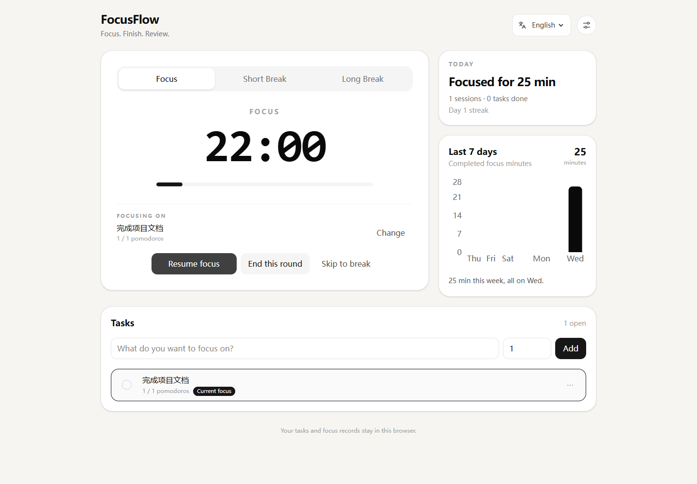
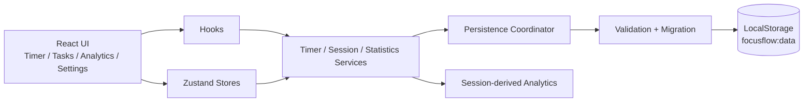

# FocusFlow · Personal Focus and Task Management

**A released web application for tasks, Pomodoro timing, focus sessions and daily analytics.**

Create today's tasks, select one to work on, and track progress through completed focus sessions. Tasks, timer state and session records are saved in the current browser and restored after a page refresh. Export a backup file to keep your records or restore them in another browser.

[Open FocusFlow](https://clear1613.github.io/FocusFlow/) · [Architecture](docs/architecture.md) · [Release record](docs/11-RELEASE.md) · [中文](README.md)

[](https://github.com/clear1613/FocusFlow/actions/workflows/ci.yml)
[](LICENSE)

<p align="center">
  
</p>

> Screenshot from the live GitHub Pages deployment, re-taken during the 2026-10-29 acceptance run with sample tasks. Mobile, dialog and dark-mode evidence: [`docs/screenshots/README.md`](docs/screenshots/README.md).

## At a glance

| | |
| --- | --- |
| **Workflow** | Create task → select task → focus → record Session → update progress → review analytics |
| **Release** | v1.2.0, backup and restore, Chinese by default with English switching |
| **Quality gate** | lint 0 errors 0 warnings · 123 tests · TypeScript and Vite build · release audit |
| **Hosting** | GitHub Pages |
| **Stack** | React 19 · TypeScript · Vite 7 · Tailwind CSS 4 · Zustand · Recharts · Vitest |
| **Data** | Business data saved in browser LocalStorage; no registration required |
| **Development** | Personal project, built end to end: requirements, frontend implementation, automated tests and deployment |

## Features

- **Tasks:** create a task and tick the circle to finish it; edit and delete live in the row's `⋯` menu; pick the current task inside the timer card.
- **Timer:** Focus, Short Break and Long Break; the button is labelled by what it does — Start focus, Pause, Resume focus, End this round, Skip.
- **Progress:** each completed Focus Session increments its linked task once.
- **Recovery:** restore timer state after refresh and process expired Sessions through the completion flow.
- **Analytics:** today's progress as one sentence (focus time, sessions, tasks, streak), plus a rule-based conclusion for the last seven days.
- **Persistence:** versioned storage, migration, validation, damaged-data fallback and incompatible-version write protection.
- **Backup and restore:** export JSON from Settings, preview an imported file, then explicitly confirm replacement. Unfinished timers restore paused; failed imports retain current data.
- **Preferences:** a settings dialog behind the header icon — durations, automatic phase starts, switch-style sound and notification, theme and data reset.
- **Interface:** system/light/dark themes, responsive layout, keyboard-accessible dialogs and focus management.
- **Languages:** Chinese by default; switch to English in the top-right corner. The choice persists after refresh.

## Using the application

The application opens in Chinese. Select **English** in the top-right language control. Switching preserves the running timer, tasks and unsaved task input.

1. Open [FocusFlow](https://clear1613.github.io/FocusFlow/), create a task and set its estimated Pomodoros.
2. Select the task and start focusing. Pause and resume when needed.
3. Review task progress when the Session completes, then take a short or long break.
4. Use the analytics panel to review today's activity and the last seven days.

Records stay in the current browser; clearing site data removes them. Use **Settings → Backup and restore** to export a file and import it on another browser or device. Import replaces current data after confirmation, so export a backup first. Files are limited to 5 MB. See the [backup guide](docs/14-BACKUP.md).

## Engineering design

### 1. Deadline-based timing and recovery

```ts
remainingSeconds = Math.max(0, Math.ceil((endAt - Date.now()) / 1000))
```

`setInterval` is only a UI refresh trigger. When a background tab is throttled
or the page is refreshed, the next tick recalculates from `endAt` and lands on
the correct value. Background timing has a separate frozen-tab acceptance check:
[`scripts/background-acceptance.py`](scripts/background-acceptance.py).

### 2. Session completion is idempotent

A Focus can reach completion from three paths: the interval tick,
`visibilitychange`, or startup recovery. `activeSessionId` is the idempotency
boundary, so a Session becomes `completed` once and increments its Task once,
regardless of how many paths fire. Pause and resume retain the same Session. Reset and skip record `cancelled` and `skipped` states, which do not count as completed focus. [`src/services/sessionService.ts`](src/services/sessionService.ts)

### 3. Analytics from session records

No `todayPomodoros` or `weeklyMinutes` counters are persisted. Today, last 7
days and current streak are all derived. Historical minutes therefore stay
stable when the user changes the focus duration or deletes a Task. Completed-task counts use Task completion timestamps separately; breaks, cancelled and skipped Sessions are excluded from focus analytics. Daily grouping uses local calendar dates.
[`src/services/statisticsService.ts`](src/services/statisticsService.ts)

### 4. Persistence is a versioned contract

```text
focusflow:data
├── version
├── tasks[]      sessions[]      activeTaskId
├── timer        settings
```

Read path: `parse → version detect → migrate → field validation → timer recovery
→ hydrate before React mounts`. Damaged JSON falls back to defaults with one
recovery notice instead of crashing; a schema written by a **newer** app version
activates write protection instead of being silently overwritten.
[`src/services/storageSchema.ts`](src/services/storageSchema.ts)

### 5. Layered implementation and test coverage

Business rules live in services with no React imports. Automated tests cover
pure functions, services, Hooks and components: timer arithmetic, legacy migration, future
version write protection, streak boundaries across local midnight, and the
"delete a task must not delete its sessions" invariant.

## Technical reading guide

| You want to see | Open |
| --- | --- |
| The hardest correctness problem | [`src/hooks/usePomodoroTimer.ts`](src/hooks/usePomodoroTimer.ts), [`docs/04-PHASE1-TIMER-CORRECTNESS.md`](docs/04-PHASE1-TIMER-CORRECTNESS.md) |
| The data model | [`src/services/storageSchema.ts`](src/services/storageSchema.ts), [`src/types/`](src/types) |
| Test strategy | [`src/services/statisticsService.test.ts`](src/services/statisticsService.test.ts), [`src/services/storageMigration.test.ts`](src/services/storageMigration.test.ts) |
| Design reasoning | [`docs/02-TECH_DESIGN.md`](docs/02-TECH_DESIGN.md), [`docs/architecture.md`](docs/architecture.md) |
| Delivery pipeline | [`.github/workflows/ci.yml`](.github/workflows/ci.yml), [`scripts/verify-release.mjs`](scripts/verify-release.mjs) |

## Release verification

**v1.2.0 local checks pass; production verification will be recorded after deployment.** Earlier results remain in the [release notes](docs/11-RELEASE.md).

| Check | Command | Last recorded result |
| --- | --- | --- |
| Lint | `npm run lint` | 0 errors, 0 warnings |
| Tests | `npm run test` | 23 files, 123 tests passing |
| Build | `npm run build` | TypeScript check and Vite build pass |
| Release audit | `npm run verify:release` | required files + lockfile + Node version + local link audit |
| Backup acceptance | `node scripts/backup-acceptance.cjs` | local 4/4 PASS: real downloads, restore, mobile, dark mode and failure protection |
| Business regression | `python scripts/browser-acceptance.py --expected-version 1.2.0` | local 11/11 PASS, no unexpected errors |
| Language acceptance | `python scripts/language-acceptance.py --expected-version 1.2.0` | local 4/4 PASS, Chinese default and English switching |

Details and dates: [`docs/10-ACCEPTANCE.md`](docs/10-ACCEPTANCE.md),
[`docs/11-RELEASE.md`](docs/11-RELEASE.md),
[`docs/acceptance/production.json`](docs/acceptance/production.json).
Browser acceptance uses isolated contexts and sample tasks. How timers are advanced is stated in each result file; background timing has a separate real-wait check.

The home-screen rework (settings behind a dialog, the current task inside the timer card, the row menu, mode-aware action labels, the today summary and the weekly conclusion) was re-verified against production on 2026-10-29: the three Python suites were updated for the new DOM, business regression **11/11** and language acceptance **4/4** against Pages, the real-wait background check passes, and a 71-check extended audit (desktop layout balance, settings-dialog focus management, timer and task switching, the row menu, 375/390 mobile viewports, dark-mode contrast, zh/en switching, the tie-aware weekly summary) passes with a clean console. The re-run caught a missing streak line in the today card's empty state, which is fixed — details in the [acceptance record](docs/10-ACCEPTANCE.md). Current unit-test baseline: **20 files / 100 tests passing**. Toolchain versions are specified in [`.nvmrc`](.nvmrc) and `packageManager`.

CI runs `npm ci → lint → test → build → verify:release`, and only then uploads
`dist` and deploys to Pages. Pull requests never deploy.

## Architecture



Full diagrams, the timer state machine and the eight invariants:
[`docs/architecture.md`](docs/architecture.md).

## Run locally

Node **24.22.1** / npm **11.21.1** — the versions the gates were verified with.

```bash
npm ci
npm run dev
```

```bash
npm run check   # lint + test + build + release audit
```

## Docs

| Doc | Content |
| --- | --- |
| [`01-PRD.md`](docs/01-PRD.md) | product scope and acceptance criteria |
| [`02-TECH_DESIGN.md`](docs/02-TECH_DESIGN.md) | state, data model, persistence, testing strategy |
| [`03-ENGINEERING.md`](docs/03-ENGINEERING.md) | directory layout, state, persistence, testing and commit conventions |
| [`04`](docs/04-PHASE1-TIMER-CORRECTNESS.md) – [`09`](docs/09-PHASE6-GITHUB-DELIVERY.md) | phase records: what broke, what was fixed, how it was verified |
| [`10-ACCEPTANCE.md`](docs/10-ACCEPTANCE.md) | acceptance record: environment, case matrix, fixed defects |
| [`11-RELEASE.md`](docs/11-RELEASE.md) | version history and release verification |
| [`13-LANGUAGE.md`](docs/13-LANGUAGE.md) | Chinese-first UI with English switching: design and verification |
| [`14-BACKUP.md`](docs/14-BACKUP.md) | backup format, preview, restore and failure protection |

## License

MIT — see [`LICENSE`](LICENSE).
