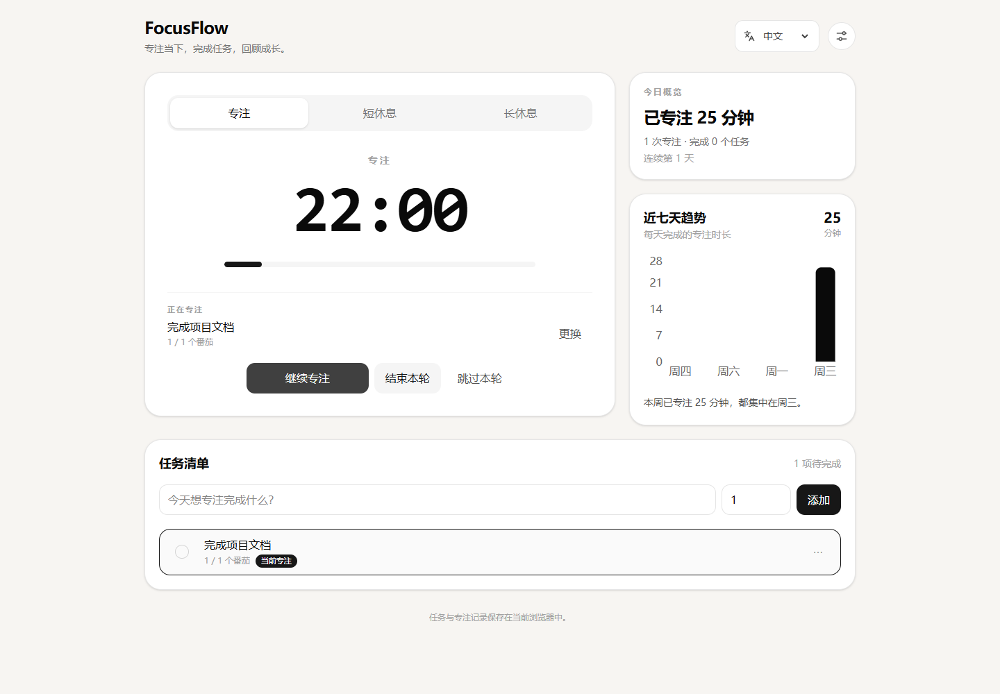
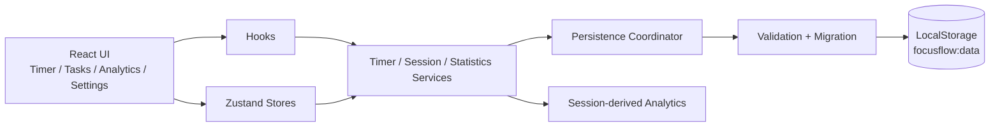

# FocusFlow · 个人专注与任务管理工具

**已发布的 Web 应用，集任务管理、番茄钟、专注记录与数据统计于一体。**

用户可以创建今天的任务，选择任务开始专注，并在完成后查看任务进度、当天专注时长和近七天趋势。任务、计时状态与专注记录保存在当前浏览器，刷新页面后可以继续使用。

[在线使用](https://clear1613.github.io/FocusFlow/) · [技术架构](docs/architecture.md) · [版本更新](docs/13-LANGUAGE.md) · [English](README.en.md)

[](https://github.com/clear1613/FocusFlow/actions/workflows/ci.yml)
[](LICENSE)

<p align="center">
  
</p>

> 正式站点运行截图（2026-10-29 验收时重拍），画面使用示例任务。更多桌面端、移动端、弹窗与暗色模式截图见 [界面截图](docs/screenshots/README.md)。

## 项目概览

| 项目 | 内容 |
| --- | --- |
| 当前版本 | v1.1.0，中文默认界面与中英文切换 |
| 完整流程 | 创建任务 → 选择任务 → 开始专注 → 记录 Session → 更新任务进度 → 查看统计 |
| 开发形式 | 个人独立开发，覆盖需求整理、前端实现、自动化测试与上线交付 |
| 核心技术 | React 19、TypeScript、Vite 7、Tailwind CSS 4、Zustand、Recharts |
| 测试与交付 | Vitest、React Testing Library、浏览器验收、GitHub Actions |
| 数据存储 | 浏览器 LocalStorage，任务、Session 和设置保存在本地 |

## 已完成功能

| 功能 | 使用方式 |
| --- | --- |
| 任务管理 | 创建任务、圆形勾选完成；编辑与删除收进每行的 `⋯` 菜单；在计时卡片里直接选择当前专注任务 |
| 专注计时 | 专注、短休息、长休息三种模式；按钮按「模式 + 状态」给出自然动作：开始专注、暂停一下、继续专注、结束本轮、跳过 |
| 进度累计 | 每完成一次专注，记录一条 Session，并累计关联任务的已完成番茄数 |
| 刷新恢复 | 页面刷新后恢复计时状态；已到期的 Session 按完成流程处理 |
| 专注统计 | 今日先给一句总结（专注时长、专注次数、完成任务、连续天数），近七天趋势自动生成一句结论 |
| 本地数据管理 | 数据持久化、旧版本迁移、字段校验、损坏数据回退与不兼容版本写保护 |
| 提醒与设置 | 右上角设置弹窗：时长与长休息间隔、自动开始、开关式声音与通知、主题、清空数据 |
| 界面适配 | 浅色、深色及系统主题，响应式布局，弹窗键盘操作与焦点管理 |
| 中英文界面 | 默认中文，右上角切换 English；保存语言选择，刷新后沿用 |

## 使用流程

首次打开默认使用中文，右上角可切换为 English。语言切换立即生效，保留正在运行的计时、任务和输入草稿。

1. 打开 [FocusFlow](https://clear1613.github.io/FocusFlow/)，创建任务并填写预计番茄数。
2. 选择当前任务，启动专注计时；需要中断时可以暂停并继续。
3. 专注结束后查看任务累计进度，进入短休息或长休息。
4. 在统计区域查看当天完成情况和近七天专注趋势。

应用无需注册。数据保存在当前浏览器；清除站点数据会移除本地记录，不同浏览器和设备之间独立保存。

## 核心工程设计

### 1. 基于截止时间的计时与恢复

```ts
remainingSeconds = Math.max(0, Math.ceil((endAt - Date.now()) / 1000))
```

`setInterval` 负责触发界面刷新，剩余时间由截止时刻计算。后台标签页恢复可见时立即校准；页面刷新后，根据保存的计时状态恢复运行或处理到期完成。

实现与验证：[计时 Hook](src/hooks/usePomodoroTimer.ts)、[恢复逻辑](src/services/timerRecoveryService.ts)、[后台计时验收](scripts/background-acceptance.py)。

### 2. Session 完成幂等

定时回调、页面可见性变化和启动恢复都可能触发完成处理。完成流程通过 `activeSessionId` 定位记录，并检查其仍处于 `running` 状态，保证同一 Session 只完成一次、关联任务只累计一次。

暂停与继续沿用同一 Session；重置和跳过分别记录为 `cancelled`、`skipped`，不计入已完成专注。

实现与测试：[Session 服务](src/services/sessionService.ts)、[Session 测试](src/services/sessionService.test.ts)。

### 3. 按专注记录计算统计

今日番茄数、专注分钟数、近七天趋势和连续专注天数均从已完成的 Focus Session 计算，使用记录中保存的实际时长。修改当前专注时长、删除任务，都不会改变已保存的历史专注分钟数。

已完成任务数单独按 Task 的完成时间计算；休息、取消和跳过的 Session 不计入专注统计。日期统计按本地自然日处理。

实现与测试：[统计服务](src/services/statisticsService.ts)、[统计测试](src/services/statisticsService.test.ts)。

### 4. 带版本的数据持久化

```text
focusflow:data
├── version
├── tasks[]
├── sessions[]
├── activeTaskId
├── timer
└── settings
```

启动读取流程为 `解析 → 版本识别与迁移 → 字段校验 → 计时恢复 → 状态注入 → React 挂载`。损坏数据回退并提示；遇到不兼容的新版本数据时开启写保护。计时运行期间按业务事件保存状态，避免每秒写入完整数据。

实现与测试：[存储服务](src/services/storageService.ts)、[字段校验](src/services/storageSchema.ts)、[迁移测试](src/services/storageMigration.test.ts)。

### 5. 分层实现与自动化交付

组件负责交互与展示，Hook 连接 React 生命周期，Zustand Store 管理运行状态，Service 承载业务规则。测试覆盖纯函数、服务、Hook 和组件，包括重复完成、刷新恢复、跨零点统计和删除任务后保留历史记录等场景。

GitHub Actions 执行 `npm ci → lint → test → build → verify:release`，检查通过后部署 GitHub Pages；Pull Request 运行检查。

## 技术架构



完整架构图、计时状态机与数据约束见 [架构说明](docs/architecture.md)。日期处理使用 date-fns，界面图表使用 Recharts。

## 验收结果

以下为 **v1.1.0 的验收结果**，首发版本 v1.0.0 的记录见[发布记录](docs/11-RELEASE.md)。

| 检查 | 命令 | 已记录结果 |
| --- | --- | --- |
| 依赖安装 | `npm ci` | 通过，审计 0 vulnerabilities |
| 静态检查 | `npm run lint` | 0 error，0 warning |
| 自动化测试 | `npm run test` | 20 个测试文件，100 个用例通过 |
| 构建 | `npm run build` | TypeScript 检查与 Vite 构建通过 |
| 发布校验 | `npm run verify:release` | 必需文件、lockfile、Node 版本与本地链接校验通过 |
| 正式站点浏览器验收 | `python scripts/browser-acceptance.py --production --expected-version 1.1.0 --url https://clear1613.github.io/FocusFlow/` | 11/11 通过，桌面端及 375×812、390×844，0 非预期控制台或页面错误 |
| 正式站点语言验收 | `python scripts/language-acceptance.py --url https://clear1613.github.io/FocusFlow/` | 4/4 通过，中文默认与中英切换 |
| 后台计时 | `python scripts/background-acceptance.py` | 实际冻结页面与真实耗时校验通过 |

浏览器验收使用独立上下文与示例任务；计时推进方式在结果文件中标注。后台计时另有真实等待验证。

首页交互改版（设置收进弹窗、当前任务并入计时卡、任务行菜单、按模式命名的动作按钮、今日总结与周报结论）已完成并于 2026-10-29 在线上复验：三个 Python 验收脚本的选择器已同步更新，业务回归线上 **11/11**、语言验收线上 **4/4**、后台计时真实等待通过；另有一轮 71 项扩展检查（桌面布局平衡、设置弹窗焦点管理、计时与任务切换、任务行菜单、375/390 移动端、暗色对比度、中英文切换、周报并列文案）全部通过且 Console 无错误。复验中发现「空状态下连续天数整行消失」并已修复（详见 [验收记录](docs/10-ACCEPTANCE.md)）。当前单元测试基线：**20 个测试文件 / 100 个用例通过**。

[发布记录](docs/11-RELEASE.md) · [完整验收记录](docs/10-ACCEPTANCE.md) · [浏览器验收结果](docs/acceptance/production.json)

## 技术阅读入口

| 关注点 | 文件 |
| --- | --- |
| 计时、暂停与恢复 | [usePomodoroTimer.ts](src/hooks/usePomodoroTimer.ts)、[timerRecoveryService.ts](src/services/timerRecoveryService.ts) |
| Session 与任务一致性 | [sessionService.ts](src/services/sessionService.ts)、[sessionService.test.ts](src/services/sessionService.test.ts) |
| 统计口径与日期边界 | [statisticsService.ts](src/services/statisticsService.ts)、[statisticsService.test.ts](src/services/statisticsService.test.ts) |
| 数据校验与迁移 | [storageSchema.ts](src/services/storageSchema.ts)、[storageMigration.test.ts](src/services/storageMigration.test.ts) |
| 自动化交付 | [ci.yml](.github/workflows/ci.yml)、[verify-release.mjs](scripts/verify-release.mjs) |

## 本地运行

已验证的工具链为 Node **24.22.1**、npm **11.21.1**，由 `.nvmrc` 和 `packageManager` 指定。

```bash
npm ci
npm run dev
```

```bash
npm run check   # lint + test + build + 发布校验
```

部署与浏览器验收操作见 [部署说明](DEPLOYMENT.md)。

## 项目文档

- [产品需求](docs/01-PRD.md)：功能范围与验收标准。
- [技术设计](docs/02-TECH_DESIGN.md)：状态、数据模型、持久化与测试策略。
- [架构说明](docs/architecture.md)：模块关系、状态机与数据约束。
- [工程规范](docs/03-ENGINEERING.md)：目录分层、状态与持久化规则、测试与提交约定。
- [发布记录](docs/11-RELEASE.md)：版本、门禁与上线记录。
- [验收记录](docs/10-ACCEPTANCE.md)：验收环境、用例矩阵与修复记录。
- [语言切换](docs/13-LANGUAGE.md)：默认中文与中英切换的设计与验证。

## 许可

MIT，见 [LICENSE](LICENSE)。
