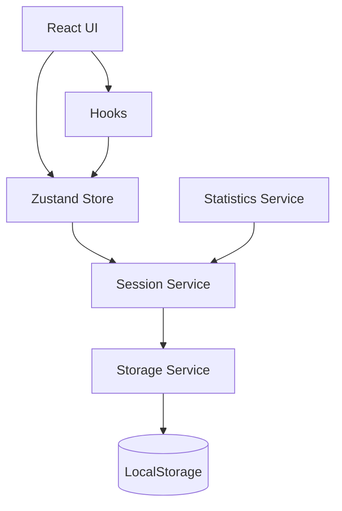
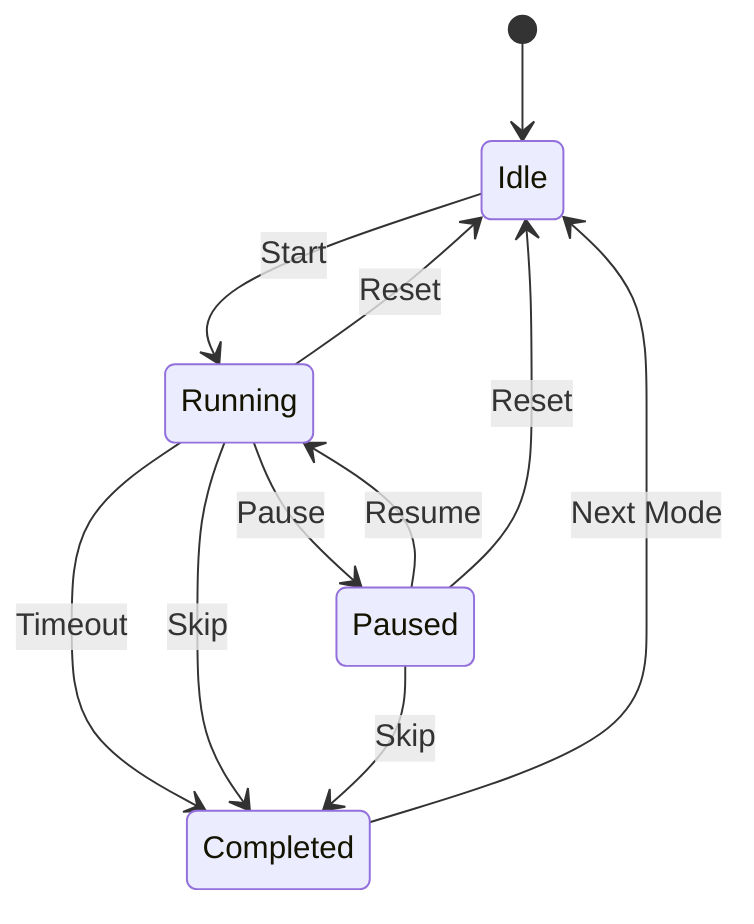
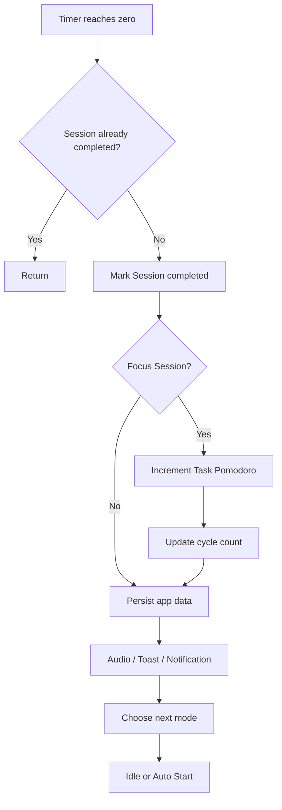

# FocusFlow —— 技术设计文档

> 文档版本：V1.0  
> 对应产品文档：`01-PRD.md`  
> 项目阶段：技术设计  
> 技术形态：纯前端 Local-first Web App  
> 目标交付：GitHub 开源仓库 + GitHub Pages 在线 Demo

---

# 1. 文档目的

本文档用于把 `01-PRD.md` 中已经确定的产品需求转换为可直接开发的技术方案。

本文不重新扩展产品范围，所有设计均围绕以下核心链路：

```text
Task
 ↓
Active Task
 ↓
Pomodoro Timer
 ↓
Focus Session
 ↓
Local Persistence
 ↓
Statistics
```

技术设计重点解决：

1. Timer 如何保证后台切换后仍然可信；
2. Timer 如何在刷新页面后恢复；
3. Session 如何避免重复创建；
4. Task 与 Session 如何解耦；
5. Statistics 如何统一从 Session 计算；
6. LocalStorage 如何避免散落式读写；
7. 数据结构升级后如何兼容旧数据；
8. React Component、Hook、Store、Service 各自负责什么；
9. 核心逻辑如何测试；
10. GitHub 项目如何保持工程结构清晰。

---

# 2. 技术目标

V1.0 技术目标如下：

- 使用 React + TypeScript 构建单页应用；
- 使用 Vite 作为构建工具；
- 使用 Tailwind CSS 完成样式；
- 使用 Zustand 管理跨组件共享状态；
- 使用 LocalStorage 做本地持久化；
- 使用 date-fns 处理日期；
- 使用 Recharts 展示最近 7 天统计；
- 使用 Notification API 发送浏览器通知；
- 使用 HTMLAudioElement 播放提示音；
- 使用 Vitest + React Testing Library 完成核心测试；
- 使用 GitHub Pages 部署；
- GitHub Actions 执行 lint、test、build。

---

# 3. 技术栈

| 分类 | 技术 | 作用 |
|---|---|---|
| UI | React | 组件化页面开发 |
| 类型系统 | TypeScript | 数据模型、状态、函数类型约束 |
| 构建 | Vite | 本地开发与生产构建 |
| 样式 | Tailwind CSS | 响应式、主题和组件样式 |
| 状态管理 | Zustand | Timer、Task、Settings 等共享状态 |
| 日期处理 | date-fns | 自然日、最近 7 天、格式化 |
| 图表 | Recharts | 最近 7 天专注趋势 |
| 持久化 | LocalStorage | Task、Session、Settings、Timer 状态 |
| 通知 | Notification API | 系统桌面通知 |
| 音频 | HTMLAudioElement | Focus/Break 完成提示音 |
| 测试 | Vitest | 单元测试 |
| 组件测试 | React Testing Library | 关键交互验证 |
| 部署 | GitHub Pages | 在线 Demo |
| CI | GitHub Actions | 自动测试与构建 |

---

# 4. 总体架构

FocusFlow 采用纯前端分层结构。

```text
┌────────────────────────────────────┐
│              React UI              │
│ Timer / Task / Stats / Settings    │
└────────────────┬───────────────────┘
                 │
                 ↓
┌────────────────────────────────────┐
│              Hooks                 │
│ usePomodoroTimer                   │
│ useNotification                    │
│ useAudio                           │
│ useDocumentTitle                   │
└────────────────┬───────────────────┘
                 │
                 ↓
┌────────────────────────────────────┐
│          Zustand Stores            │
│ timerStore                         │
│ taskStore                          │
│ settingsStore                      │
└────────────────┬───────────────────┘
                 │
                 ↓
┌────────────────────────────────────┐
│             Services               │
│ sessionService                     │
│ storageService                     │
│ statisticsService                  │
│ notificationService               │
│ audioService                       │
└────────────────┬───────────────────┘
                 │
                 ↓
┌────────────────────────────────────┐
│           LocalStorage             │
│ focusflow:data                     │
└────────────────────────────────────┘
```

核心原则：

> UI 不直接操作 LocalStorage，Component 不直接实现复杂业务状态机，Statistics 不维护独立事实数据。

---

# 5. 目录结构

建议仓库结构：

```text
focus-flow/
│
├── public/
│   ├── sounds/
│   │   ├── focus-complete.mp3
│   │   └── break-complete.mp3
│   └── favicon.svg
│
├── src/
│   ├── components/
│   │   ├── timer/
│   │   │   ├── TimerCard.tsx
│   │   │   ├── TimerDisplay.tsx
│   │   │   ├── TimerControls.tsx
│   │   │   ├── ModeTabs.tsx
│   │   │   └── ProgressRing.tsx
│   │   │
│   │   ├── task/
│   │   │   ├── TaskList.tsx
│   │   │   ├── TaskItem.tsx
│   │   │   ├── ActiveTask.tsx
│   │   │   ├── AddTaskModal.tsx
│   │   │   └── EditTaskModal.tsx
│   │   │
│   │   ├── statistics/
│   │   │   ├── TodayStats.tsx
│   │   │   ├── WeeklyChart.tsx
│   │   │   └── StreakCard.tsx
│   │   │
│   │   ├── settings/
│   │   │   └── SettingsPanel.tsx
│   │   │
│   │   └── common/
│   │       ├── Button.tsx
│   │       ├── Modal.tsx
│   │       ├── Toast.tsx
│   │       └── ConfirmDialog.tsx
│   │
│   ├── hooks/
│   │   ├── usePomodoroTimer.ts
│   │   ├── useNotification.ts
│   │   ├── useAudio.ts
│   │   ├── useDocumentTitle.ts
│   │   └── useTheme.ts
│   │
│   ├── stores/
│   │   ├── timerStore.ts
│   │   ├── taskStore.ts
│   │   └── settingsStore.ts
│   │
│   ├── services/
│   │   ├── storageService.ts
│   │   ├── sessionService.ts
│   │   ├── statisticsService.ts
│   │   ├── notificationService.ts
│   │   └── audioService.ts
│   │
│   ├── types/
│   │   ├── timer.ts
│   │   ├── task.ts
│   │   ├── session.ts
│   │   ├── settings.ts
│   │   └── storage.ts
│   │
│   ├── utils/
│   │   ├── time.ts
│   │   ├── date.ts
│   │   ├── id.ts
│   │   └── validation.ts
│   │
│   ├── constants/
│   │   └── defaults.ts
│   │
│   ├── App.tsx
│   ├── main.tsx
│   └── index.css
│
├── tests/
│   ├── timer/
│   ├── task/
│   ├── storage/
│   └── statistics/
│
├── docs/
│   ├── architecture.md
│   └── screenshots/
│
├── .github/
│   └── workflows/
│       └── ci.yml
│
├── 01-PRD.md
├── 02-TECH_DESIGN.md
├── 03-ENGINEERING.md
├── README.md
├── package.json
├── tsconfig.json
├── vite.config.ts
└── .gitignore
```

---

# 6. 分层职责

## 6.1 Components

只负责：

- 页面结构；
- 数据展示；
- 用户交互入口；
- 调用 Hook / Store 暴露的方法。

禁止：

- 直接读写 LocalStorage；
- 自己计算统计口径；
- 自己实现完整 Timer 状态机；
- 在多个组件重复实现通知和音频逻辑。

---

## 6.2 Hooks

负责：

- 把 React 生命周期和业务能力结合；
- 处理副作用；
- 对 Component 暴露简单接口。

例如：

```text
usePomodoroTimer
```

负责把：

```text
setInterval
visibility / refresh restore
store state
session completion
```

组合起来。

---

## 6.3 Stores

负责：

- 保存运行时状态；
- 提供状态变更入口；
- 确保同类状态只有一个来源。

Store 不承担：

- LocalStorage Schema Migration；
- 复杂统计聚合；
- Browser API 兼容处理。

---

## 6.4 Services

负责：

- 存储；
- Session 生成；
- 统计计算；
- Notification；
- Audio。

Service 尽量保持可测试、与 UI 解耦。

---

# 7. TypeScript 核心数据模型

---

# 8. Timer 类型设计

```ts
export type TimerMode =
  | 'focus'
  | 'short_break'
  | 'long_break';

export type TimerStatus =
  | 'idle'
  | 'running'
  | 'paused'
  | 'completed';
```

Timer 状态：

```ts
export interface TimerState {
  mode: TimerMode;
  status: TimerStatus;

  remainingSeconds: number;

  startedAt: number | null;
  endAt: number | null;

  activeSessionId: string | null;

  completedFocusCountInCycle: number;
}
```

字段说明：

| 字段 | 含义 |
|---|---|
| mode | 当前 Focus / Short Break / Long Break |
| status | Idle / Running / Paused / Completed |
| remainingSeconds | 当前展示剩余秒数 |
| startedAt | 当前阶段首次开始时间 |
| endAt | Running 状态真实结束时间 |
| activeSessionId | 当前运行中的 Session ID |
| completedFocusCountInCycle | 当前长休息周期已完成 Focus 数 |

---

# 9. Task 类型设计

```ts
export type TaskStatus = 'todo' | 'completed';

export interface Task {
  id: string;
  title: string;

  estimatedPomodoros: number;
  completedPomodoros: number;

  status: TaskStatus;

  createdAt: number;
  completedAt: number | null;
}
```

注意：

`completedPomodoros` 可以作为 UI 快速展示字段，但其更新必须只发生在 Session 完成事务中。

不能：

```text
Timer 完成
→ UI 自己 +1
```

必须统一经过业务方法。

---

# 10. Session 类型设计

```ts
export type SessionType =
  | 'focus'
  | 'short_break'
  | 'long_break';

export type SessionStatus =
  | 'running'
  | 'completed'
  | 'cancelled'
  | 'skipped';
```

```ts
export interface FocusSession {
  id: string;

  taskId: string | null;

  type: SessionType;
  status: SessionStatus;

  startedAt: number;
  endedAt: number | null;

  plannedDurationSeconds: number;
  actualDurationSeconds: number;

  completedAt: number | null;
}
```

V1.0 虽然统计主要使用 Focus Session，但 Break 也可以统一使用同一个 Session 结构保存。

统计时通过：

```text
type === focus
AND
status === completed
```

过滤。

---

# 11. Settings 类型设计

```ts
export interface TimerSettings {
  focusMinutes: number;
  shortBreakMinutes: number;
  longBreakMinutes: number;

  longBreakInterval: number;

  autoStartBreak: boolean;
  autoStartFocus: boolean;

  soundEnabled: boolean;
  notificationEnabled: boolean;
}
```

主题单独：

```ts
export type ThemeMode =
  | 'system'
  | 'light'
  | 'dark';
```

```ts
export interface AppSettings extends TimerSettings {
  theme: ThemeMode;
}
```

---

# 12. App 持久化模型

整个 LocalStorage 使用单一根对象：

```ts
export interface PersistedAppData {
  version: number;

  tasks: Task[];
  sessions: FocusSession[];

  activeTaskId: string | null;

  timer: TimerState;

  settings: AppSettings;
}
```

LocalStorage Key：

```text
focusflow:data
```

禁止多个组件分别创建：

```text
focusflow:tasks
focusflow:timer
focusflow:stats
```

V1.0 使用一个根对象，便于：

- 一致写入；
- Schema 版本管理；
- Migration；
- 数据导出；
- 数据恢复。

---

# 13. 默认数据

建议：

```ts
export const DEFAULT_SETTINGS: AppSettings = {
  focusMinutes: 25,
  shortBreakMinutes: 5,
  longBreakMinutes: 15,

  longBreakInterval: 4,

  autoStartBreak: false,
  autoStartFocus: false,

  soundEnabled: true,
  notificationEnabled: false,

  theme: 'system',
};
```

Timer 默认：

```ts
export const DEFAULT_TIMER_STATE: TimerState = {
  mode: 'focus',
  status: 'idle',

  remainingSeconds: 25 * 60,

  startedAt: null,
  endAt: null,

  activeSessionId: null,

  completedFocusCountInCycle: 0,
};
```

---

# 14. ID 生成方案

Task 和 Session 必须使用稳定唯一 ID。

V1.0 优先使用：

```ts
crypto.randomUUID()
```

回退方案：

```text
timestamp + random
```

封装：

```text
utils/id.ts
```

Component 不直接生成 ID。

---

# 15. Timer 状态机

Timer 的核心不是倒计时，而是状态转换。

状态：

```text
IDLE
RUNNING
PAUSED
COMPLETED
```

允许转换：

```text
IDLE
  └── start → RUNNING

RUNNING
  ├── pause → PAUSED
  ├── reset → IDLE
  ├── skip → COMPLETED / next mode
  └── timeout → COMPLETED

PAUSED
  ├── resume → RUNNING
  ├── reset → IDLE
  └── skip → COMPLETED / next mode

COMPLETED
  └── transition → IDLE / RUNNING
```

禁止无意义转换，例如：

```text
IDLE → pause
PAUSED → pause
RUNNING → start
```

Store action 必须自行保护。

---

# 16. Timer Store

建议状态：

```ts
interface TimerStore {
  timer: TimerState;

  start(): void;
  pause(): void;
  resume(): void;
  reset(): void;
  skip(): void;

  syncNow(now?: number): void;

  completeCurrentSession(): void;

  transitionToNextMode(): void;

  restoreFromPersistedState(): void;
}
```

其中：

```text
syncNow()
```

是整个 Timestamp Timer 的关键入口。

---

# 17. Timestamp Timer 设计

## 17.1 开始

例如 Focus 25 分钟。

```text
now = Date.now()

duration = 25 * 60 * 1000

endAt = now + duration
```

保存：

```text
startedAt = now
endAt = ...
status = running
```

---

## 17.2 UI Tick

UI 可以继续每秒执行：

```text
setInterval(..., 1000)
```

但 interval 只负责：

> 触发重新计算。

而不是：

```text
remainingSeconds--
```

正确逻辑：

```ts
remainingSeconds =
  Math.max(
    0,
    Math.ceil((endAt - Date.now()) / 1000)
  );
```

---

## 17.3 为什么使用 Math.ceil

如果剩余：

```text
24,200 ms
```

展示：

```text
25 sec
```

比直接 floor 更符合倒计时视觉。

到：

```text
endAt <= now
```

时统一判定完成。

---

# 18. Pause 设计

暂停时：

```text
remainingSeconds
=
ceil((endAt - now) / 1000)
```

然后：

```text
status = paused
endAt = null
```

保持：

```text
startedAt
activeSessionId
```

不变。

---

# 19. Resume 设计

恢复：

```text
endAt =
Date.now()
+
remainingSeconds * 1000
```

然后：

```text
status = running
```

---

# 20. Reset 设计

Reset 前：

若：

```text
status === running
OR
status === paused
```

需要 UI 二次确认。

确认后：

当前 Session：

```text
status = cancelled
endedAt = now
actualDurationSeconds = 已运行时间
```

Timer：

```text
status = idle
startedAt = null
endAt = null
activeSessionId = null
remainingSeconds = 当前 mode 默认时间
```

---

# 21. Skip 设计

Focus 被 Skip：

当前 Session：

```text
status = skipped
```

不能：

- completedPomodoros +1；
- 今日番茄 +1；
- Streak +1。

Break Skip：

只结束当前 Break Session，并进入下一个 Focus。

---

# 22. Timer 完成流程

当：

```text
remainingSeconds <= 0
```

进入：

```text
completeCurrentSession()
```

核心顺序必须固定：

```text
1. 判断当前 Session 是否已完成
2. 写 Session completed
3. 更新 Task
4. 更新 cycle count
5. 持久化
6. 触发通知 / 音频
7. 计算 next mode
8. 切换 Timer
```

避免 UI 和业务状态不同步。

---

# 23. Session 幂等设计

这是 V1.0 必须解决的技术点。

可能出现：

```text
setInterval 正好触发 complete
+
visibilitychange 再次 sync
+
刷新页面 restore 再次检查 endAt
```

如果没有保护，可能：

```text
同一个 Focus
生成 2~3 个 completed Session
```

所以完成逻辑必须是幂等的。

---

# 24. 幂等键

每次启动 Timer 时先生成：

```text
activeSessionId
```

例如：

```text
d8c2...
```

整个本轮 Timer 生命周期保持不变。

完成时先查：

```text
sessions.find(
  session.id === activeSessionId
)
```

如果：

```text
status === completed
```

则：

```text
return
```

不重复执行完成副作用。

---

# 25. Session 创建时机

推荐：

> Start 时立即创建 running Session。

而不是等完成以后才创建。

流程：

```text
Start
 ↓
create running session
 ↓
store activeSessionId
 ↓
Timer running
```

原因：

- Pause/Resume 有明确归属；
- Reset 可以记录 cancelled；
- Skip 可以记录 skipped；
- 刷新页面后仍知道当前 Timer 对应哪个 Session。

---

# 26. Session 完成原子流程

纯前端不存在数据库事务，因此需要在内存中一次性构造新状态，再统一 persist。

伪逻辑：

```ts
completeSession(sessionId) {
  const session = findSession(sessionId);

  if (!session) return;
  if (session.status === 'completed') return;

  const updatedSession = ...
  const updatedTasks = ...
  const updatedTimer = ...

  const nextData = {
    ...currentData,
    sessions: updatedSessions,
    tasks: updatedTasks,
    timer: updatedTimer,
  };

  storage.save(nextData);
}
```

重点：

> 不要分成多个互相独立的 LocalStorage 写入。

---

# 27. Task Store

建议：

```ts
interface TaskStore {
  tasks: Task[];
  activeTaskId: string | null;

  createTask(input): void;
  updateTask(id, patch): void;
  deleteTask(id): void;

  completeTask(id): void;

  setActiveTask(id): void;
  clearActiveTask(): void;

  incrementCompletedPomodoro(id): void;
}
```

其中：

```text
incrementCompletedPomodoro
```

只允许 Session 完成流程调用。

UI 不直接调用。

---

# 28. Task 删除规则

删除 Task 时：

```text
tasks 中删除
```

Session 不删除。

因此 Session 的：

```text
taskId
```

可能指向一个已删除 Task。

统计层必须允许：

```text
taskId 存在但 Task 不存在
```

后续历史详情可以显示：

```text
Deleted Task
```

V1.0 不需要软删除。

---

# 29. 修改 Task 名称与历史 Session

Session 不复制 Task title。

Session 只保存：

```text
taskId
```

因此 Task 修改标题后：

当前任务和历史关联显示新名称。

V1.0 接受这一行为。

如果以后要严格保留历史快照，再增加：

```text
taskTitleSnapshot
```

不在 V1.0 范围。

---

# 30. Settings Store

建议：

```ts
interface SettingsStore {
  settings: AppSettings;

  updateTimerDuration(...): void;
  updateLongBreakInterval(...): void;

  setAutoStartBreak(value): void;
  setAutoStartFocus(value): void;

  setSoundEnabled(value): void;
  setNotificationEnabled(value): void;

  setTheme(value): void;

  resetSettings(): void;
}
```

---

# 31. 修改时长时的行为

如果 Timer：

```text
idle
```

则立即更新：

```text
remainingSeconds
```

如果 Timer：

```text
running
paused
```

只更新 Settings。

当前 Timer 的：

```text
plannedDurationSeconds
remainingSeconds
endAt
```

都保持不变。

下一轮才使用新值。

---

# 32. 长休息周期设计

变量：

```text
completedFocusCountInCycle
```

每完成一个 Focus：

```text
+1
```

如果：

```text
completedFocusCountInCycle
<
longBreakInterval
```

进入：

```text
short_break
```

如果达到：

```text
longBreakInterval
```

进入：

```text
long_break
```

然后周期计数归零。

---

# 33. 自动开始规则

Focus 完成后：

如果 next mode 是 Break：

```text
autoStartBreak === true
```

则直接 Start。

否则：

```text
进入 break mode
status = idle
```

Break 完成后：

如果：

```text
autoStartFocus === true
```

则自动 Start。

---

# 34. usePomodoroTimer

这是项目核心 Hook。

职责：

```text
1. 订阅 timerStore
2. Running 时建立 UI Tick
3. 每次 Tick 调用 syncNow()
4. 监听 visibilitychange
5. 页面重新可见时 syncNow()
6. 页面加载后执行 restore
7. Timer 完成时触发副作用
```

Hook 不应直接操作 DOM。

---

# 35. Tick 生命周期

伪流程：

```ts
useEffect(() => {
  if (status !== 'running') return;

  syncNow();

  const id = window.setInterval(() => {
    syncNow();
  }, 1000);

  return () => clearInterval(id);
}, [status, endAt]);
```

这里 interval 只是：

> UI refresh trigger。

不是时间事实源。

---

# 36. visibilitychange 处理

监听：

```text
document.visibilitychange
```

页面重新变为：

```text
visible
```

时：

```text
syncNow(Date.now())
```

确保用户返回页面后立即校准。

---

# 37. 页面恢复逻辑

应用初始化：

```text
load persisted data
 ↓
validate
 ↓
migrate
 ↓
hydrate stores
 ↓
restore timer
```

如果 timer：

```text
status = running
```

则检查：

```text
endAt
```

---

# 38. Running Timer 未过期

如果：

```text
Date.now() < endAt
```

则：

```text
remainingSeconds =
ceil((endAt - now) / 1000)
```

继续 Running。

---

# 39. Running Timer 已过期

如果：

```text
Date.now() >= endAt
```

需要执行：

```text
completeCurrentSession()
```

但必须经过 activeSessionId 幂等校验。

---

# 40. Paused Timer 恢复

如果：

```text
status = paused
```

只恢复：

```text
remainingSeconds
```

不重新计算：

```text
endAt
```

直到用户点击 Resume。

---

# 41. storageService

所有 LocalStorage 操作统一在：

```text
services/storageService.ts
```

接口建议：

```ts
load(): PersistedAppData

save(data: PersistedAppData): void

clear(): void

validate(raw: unknown): boolean

migrate(raw: unknown): PersistedAppData
```

---

# 42. LocalStorage Schema Version

常量：

```ts
export const STORAGE_VERSION = 1;
```

保存：

```json
{
  "version": 1
}
```

读取时：

```text
raw.version
 ↓
与 CURRENT_VERSION 比较
```

---

# 43. Migration 结构

V1.0 暂时只有：

```text
version 1
```

但代码结构预留：

```ts
const migrations = {
  1: migrateToV1,
  2: migrateToV2,
};
```

以后：

```text
V1
 ↓
migrateToV2
 ↓
V2
```

不需要重写整个 Storage。

---

# 44. 数据校验

读取 LocalStorage 后不能直接：

```ts
JSON.parse(...)
as PersistedAppData
```

至少需要基础字段校验：

```text
version
tasks
sessions
timer
settings
```

以及：

```text
Array.isArray(tasks)
Array.isArray(sessions)
```

关键枚举字段需要合法。

V1.0 可以自己写轻量 validation。

不强制引入 Zod。

---

# 45. 损坏数据处理

流程：

```text
getItem
 ↓
JSON.parse
 ↓
validate
```

任一步失败：

```text
catch
 ↓
使用 default data
 ↓
记录 console.warn
 ↓
给 UI 返回 recovery flag
```

UI：

```text
本地数据读取失败，已恢复默认配置。
```

只显示一次。

---

# 46. Storage 写入策略

V1.0 数据规模较小。

允许每次关键状态变化直接：

```text
JSON.stringify
+
localStorage.setItem
```

但 Timer 每秒 Tick 不应每秒持久化完整对象。

推荐：

### 必须持久化

- Start；
- Pause；
- Resume；
- Reset；
- Complete；
- Skip；
- Task CRUD；
- Settings 更新。

### 不必每秒持久化

```text
remainingSeconds
```

因为 Running 状态可以根据：

```text
endAt
```

恢复。

---

# 47. Statistics Service

统计逻辑统一放：

```text
services/statisticsService.ts
```

禁止组件自行：

```text
filter + reduce
```

重复实现。

接口建议：

```ts
getTodayStats(sessions, tasks, now)

getLast7DaysFocusMinutes(sessions, now)

getCurrentStreak(sessions, now)
```

---

# 48. 今日番茄数

过滤：

```text
session.type === focus
session.status === completed
completedAt 属于今天
```

数量即今日番茄数。

---

# 49. 今日 Focus Minutes

过滤同上。

计算：

```text
sum(actualDurationSeconds)
/
60
```

---

# 50. 最近 7 天

先生成：

```text
今天以及前 6 天
```

完整日期数组。

再逐日聚合。

即使某日没有 Session：

```text
minutes = 0
```

这样图表不会缺日期。

---

# 51. Current Streak

从今天开始向前检查。

规则：

如果今天已有 completed Focus：

```text
today active
```

继续向前。

如果今天尚未完成 Focus：

可以从昨天开始计算当前已保持的连续天数。

V1.0 推荐采用更符合用户习惯的规则：

> 今天没有完成 Focus 不立即把昨日连续记录显示为 0；只有跨过一个完整未活跃自然日后才中断。

例如：

昨天已有 5 天连续记录，今天中午尚未开始：

```text
Current Streak = 5
```

今天结束仍无记录后，明天打开：

```text
Current Streak = 0
```

---

# 52. 日期与时区

统计使用：

> 用户浏览器本地时区。

不存：

```text
YYYY-MM-DD
```

作为事实时间。

Session 保存：

```text
Unix Timestamp(ms)
```

展示和按自然日统计时再根据本地时区计算。

---

# 53. Notification Service

接口：

```ts
isSupported(): boolean

getPermission(): NotificationPermission

requestPermission():
  Promise<NotificationPermission>

notify(title, body): void
```

调用者不直接：

```ts
new Notification(...)
```

---

# 54. 通知权限规则

不在页面加载时自动：

```text
requestPermission()
```

只有用户主动开启：

```text
Desktop Notification
```

时才调用。

---

# 55. Audio Service

接口：

```ts
playFocusComplete(): Promise<void>

playBreakComplete(): Promise<void>
```

内部统一：

```text
try / catch
```

音频失败不能抛出导致 Timer 完成流程失败。

---

# 56. useDocumentTitle

根据 Timer 状态设置：

```text
running focus
→ 24:31 · FocusFlow

running break
→ 04:20 · Break · FocusFlow

otherwise
→ FocusFlow
```

组件卸载时恢复默认 title。

---

# 57. Theme 设计

Theme：

```text
system
light
dark
```

实现方式：

```text
<html class="dark">
```

Tailwind：

```text
dark:
```

system 模式：

```text
window.matchMedia(
  '(prefers-color-scheme: dark)'
)
```

---

# 58. UI 页面结构

App：

```text
App
│
├── Header
│
├── Main
│   ├── TimerCard
│   ├── ActiveTask
│   ├── TaskList
│   └── TodayStats
│
├── WeeklyChart
│
└── SettingsPanel
```

V1.0 不强制使用 React Router。

单页即可。

---

# 59. TimerCard

TimerCard 负责展示：

- 当前 Mode；
- 剩余 MM:SS；
- Progress；
- Start / Pause / Resume；
- Reset；
- Skip。

它只读取：

```text
timerStore
```

调用：

```text
usePomodoroTimer
```

暴露的 action。

---

# 60. Progress 计算

当前模式计划总秒数：

```text
plannedDurationSeconds
```

进度：

```text
1 - remaining / planned
```

范围必须 clamp：

```text
0 ~ 1
```

---

# 61. ActiveTask

显示：

```text
Current Task
任务名称
完成番茄 / 预计番茄
```

无当前任务：

```text
No task selected
```

仍允许 Timer 工作。

---

# 62. TaskList

默认仅展示：

```text
status = todo
```

已完成任务 V1.0 可以放在：

```text
Completed
```

折叠区。

避免首页无限变长。

---

# 63. Task Modal

创建 / 编辑共用 Form。

字段：

```text
title
estimatedPomodoros
```

表单层先做同步校验。

---

# 64. ConfirmDialog

至少使用在：

- Reset Running Timer；
- Delete Task with Sessions；
- Reset All Data。

统一组件，避免每处自己写确认 UI。

---

# 65. Toast

用途：

- Focus 完成；
- Break 完成；
- Storage Recovery；
- Notification 权限异常；
- Task 操作结果。

不使用浏览器原生：

```text
alert()
```

作为主要交互。

---

# 66. 错误边界

V1.0 建议增加顶层：

```text
ErrorBoundary
```

用于捕获 React 渲染异常。

Fallback：

```text
FocusFlow 出现异常
请刷新页面重试
```

如果本地数据仍异常，可引导：

```text
Reset Local Data
```

---

# 67. 性能设计

V1.0 数据量小，不需要复杂优化。

但保持：

- Chart 数据使用 memo；
- Statistics 统一计算；
- Timer Tick 只更新必要状态；
- 不每秒写 LocalStorage；
- Task 列表使用稳定 key；
- 避免整个 App 因 Timer 每秒更新全部重渲染。

---

# 68. Store 拆分原因

不使用一个超大：

```text
appStore
```

建议拆成：

```text
timerStore
taskStore
settingsStore
```

原因：

- Timer 每秒更新频率高；
- Task 更新低频；
- Settings 更低频；
- 避免 Timer Tick 让整个任务区重复渲染。

---

# 69. Session 存储位置

Session 不建议单独使用高频 Zustand Store。

V1.0 可以通过：

```text
sessionService + persisted state
```

统一维护。

如果需要 UI 历史页再增加：

```text
sessionStore
```

V1.0 暂不需要。

---

# 70. App 初始化流程

```text
main.tsx
 ↓
storageService.load()
 ↓
parse
 ↓
validate
 ↓
migrate
 ↓
hydrate stores
 ↓
restore timer
 ↓
render App
```

如果 recovery：

```text
render App
+
show Toast
```

---

# 71. Persist 协调

为了避免 Store 各自保存造成根对象覆盖问题，建议提供：

```text
persistAppState()
```

它从各 Store / Session Source 收集当前状态，然后一次写入：

```text
focusflow:data
```

---

# 72. 业务 Action 与 Persist

例如：

```text
createTask()
```

内部：

```text
update store
 ↓
persist
```

而不是 Component：

```text
createTask()
storage.save()
```

否则容易漏保存。

---

# 73. Reset All Data

流程：

```text
Confirm
 ↓
storage.clear()
 ↓
reset all stores
 ↓
sessions = []
 ↓
恢复 defaults
```

重置后不强制刷新页面。

---

# 74. 数据备份

V1.0 不做导入导出。

但单根对象：

```text
focusflow:data
```

为 V1.1 JSON Export 做准备。

---

# 75. 测试总体策略

分三层：

```text
Unit
 ↓
Store / Service
 ↓
Component Integration
```

不做复杂 E2E 作为 V1.0 硬要求。

如果时间允许，可后续加 Playwright。

---

# 76. Timer Unit Tests

必须覆盖：

### T-TIMER-01

Start：

```text
idle
→ running
```

并创建：

```text
activeSessionId
endAt
```

---

### T-TIMER-02

Pause：

```text
running
→ paused
```

剩余时间正确。

---

### T-TIMER-03

Resume：

```text
paused
→ running
```

endAt 重新生成。

---

### T-TIMER-04

后台时间校准：

模拟：

```text
startAt = 0
endAt = 300000
now = 180000
```

预期：

```text
remaining = 120 sec
```

---

### T-TIMER-05

Timer 到期：

```text
now >= endAt
```

只完成一次。

---

### T-TIMER-06

重复 complete：

调用两次：

```text
completeCurrentSession()
```

预期：

```text
仅 1 个 completed Session
Task completedPomodoros +1
```

---

### T-TIMER-07

4 次 Focus：

默认：

```text
longBreakInterval = 4
```

第四次完成后进入：

```text
long_break
```

---

# 77. Task Tests

覆盖：

- 创建；
- 编辑；
- 删除；
- 完成；
- 设置 Active Task；
- 删除 Active Task 后清除 activeTaskId；
- Session 完成后 completedPomodoros +1；
- 删除 Task 不删除历史 Session。

---

# 78. Storage Tests

覆盖：

- 默认数据读取；
- 正常保存；
- 正常加载；
- JSON 损坏；
- 字段缺失；
- version 不合法；
- migration；
- clear。

---

# 79. Statistics Tests

固定时间避免时区测试漂移。

覆盖：

- 今日 Focus 数；
- 今日分钟数；
- 7 天无数据补 0；
- 跨日期 Session；
- cancelled 不统计；
- skipped 不统计；
- Break 不统计；
- Current Streak。

---

# 80. Component Tests

至少：

### TimerControls

不同状态显示正确按钮。

### Task Form

空标题不能提交。

### Delete Dialog

有 Session 时出现确认。

### Settings

Running 状态修改时长不影响当前 Timer。

---

# 81. 时间测试方式

业务函数尽量支持传入：

```text
now
```

而不是内部全部硬编码：

```text
Date.now()
```

例如：

```ts
syncTimer(timer, now)
```

这样测试无需依赖真实时间。

---

# 82. Fake Timer

Vitest 使用：

```text
vi.useFakeTimers()
```

验证：

- tick；
- timer；
- completion。

但核心时间计算函数仍优先做纯函数测试。

---

# 83. 工具函数

建议：

```text
utils/time.ts
```

包含：

```ts
formatSeconds(seconds)

getRemainingSeconds(endAt, now)

getModeDurationSeconds(mode, settings)

clampProgress(value)
```

全部纯函数。

---

# 84. 日期工具

```text
utils/date.ts
```

包含：

```text
isSameLocalDay

startOfLocalDay

getLast7LocalDays
```

实际可以基于：

```text
date-fns
```

实现。

---

# 85. Validation

Task：

```text
title.trim().length
1 ~ 80
```

Pomodoro：

```text
1 ~ 99
```

Settings：

按 PRD 范围：

```text
Focus 1~120
Short 1~60
Long 1~120
Interval 1~12
```

---

# 86. 可访问性

至少保证：

- Button 有明确文字或 aria-label；
- Modal 可以 Esc 关闭；
- Modal 有 focus trap 或至少合理焦点管理；
- 输入框有 label；
- 不能只靠颜色表达 Timer 状态；
- 图表旁显示数值摘要。

---

# 87. 响应式

建议断点：

```text
mobile < 768px
desktop >= 768px
```

桌面：

```text
Timer 主区域
+
Task / Stats 两列
```

移动端：

```text
Timer
Task
Stats
```

---

# 88. 样式原则

避免：

- 大量渐变；
- 玻璃拟态堆叠；
- 高频动画；
- 过多卡片；
- Dashboard 信息过载。

主要突出：

```text
Timer
Current Task
Primary Action
```

---

# 89. 安全与隐私

V1.0：

- 不上传用户数据；
- 不使用服务器；
- 不采集个人信息；
- 不要求登录；
- 所有业务数据保存在浏览器 LocalStorage。

README 中明确：

> FocusFlow V1.0 stores task and focus data locally in the browser.

---

# 90. 第三方依赖原则

尽量保持依赖少。

必须：

```text
react
react-dom
zustand
date-fns
recharts
```

开发依赖：

```text
typescript
vite
tailwind
vitest
@testing-library/react
```

不为了一个简单功能引入大型库。

---

# 91. Lint 与 Format

建议：

```text
ESLint
Prettier
```

CI 必须至少执行：

```bash
npm run lint
npm run test
npm run build
```

---

# 92. package scripts

建议：

```json
{
  "scripts": {
    "dev": "vite",
    "build": "tsc -b && vite build",
    "preview": "vite preview",
    "lint": "eslint .",
    "test": "vitest run",
    "test:watch": "vitest"
  }
}
```

---

# 93. GitHub Actions

触发：

```text
push
pull_request
```

步骤：

```text
checkout
setup node
npm ci
npm run lint
npm run test
npm run build
```

任何一步失败：

```text
CI Failed
```

---

# 94. 静态部署

构建：

```text
npm run build
```

输出：

```text
dist/
```

无后端环境变量依赖。

因此在任意静态托管上都能直接部署；仓库自带的 Pages workflow 会在质量门禁通过后发布 `dist`。

---

# 95. 浏览器兼容

目标：

- Chrome 最新版；
- Edge 最新版；
- Firefox 最新版；
- Safari 较新版本。

Notification API 不支持时：

```text
graceful degradation
```

核心 Timer 不能依赖 Notification。

---

# 96. PWA

V1.0 不实现。

原因：

PWA 会带入：

```text
Service Worker
offline cache
update strategy
install behavior
```

容易扩大项目范围。

放入 V1.1。

---

# 97. Wake Lock

V1.0 不作为 P0。

如果后续实现：

```text
Screen Wake Lock API
```

只作为增强能力。

不影响核心 Timer。

---

# 98. 不使用 Web Worker 的原因

V1.0 不依赖 Web Worker 维持计时准确。

因为核心 Timer 已经采用：

```text
endAt - Date.now()
```

即使 UI tick 被限频：

真实时间仍能恢复。

Web Worker 可以作为后续优化，但不是正确性的基础。

---

# 99. 关键技术取舍

## 99.1 LocalStorage vs 后端数据库

选择：

```text
LocalStorage
```

因为：

- 单用户；
- 本地工具；
- 无账号；
- 无同步需求；
- 部署简单。

---

## 99.2 Zustand vs Context

选择：

```text
Zustand
```

原因：

- Timer 更新频率高；
- 多区域共享状态；
- API 简洁；
- 可以精确 selector；
- 比大型 Redux 更适合当前规模。

---

## 99.3 Timestamp vs decrement counter

选择：

```text
Timestamp
```

原因：

> Timer 正确性不能依赖浏览器是否每秒调度一次回调。

---

## 99.4 Session Fact vs aggregate counter

选择：

```text
Session Fact
```

原因：

统计可以重算。

如果只保存：

```text
todayCount
```

则数据难以追溯。

---

# 100. 核心不变量

以下规则必须在开发过程中一直成立：

### INV-01

同一时刻最多一个：

```text
activeSessionId
```

### INV-02

一个 Session 最多完成一次。

### INV-03

一个 completed Focus 最多让 Task：

```text
completedPomodoros +1
```

一次。

### INV-04

Statistics 只从 Session 计算，不手工累计独立统计字段。

### INV-05

删除 Task 不删除 Session。

### INV-06

Running Timer 必须有：

```text
endAt
activeSessionId
```

### INV-07

Paused Timer：

```text
endAt = null
```

### INV-08

Idle Timer：

```text
activeSessionId = null
```

---

# 101. 开发顺序

## Phase 1

初始化：

```text
React
TypeScript
Vite
Tailwind
ESLint
Vitest
```

建立目录。

---

## Phase 2

实现纯函数：

```text
time utils
date utils
validation
types
defaults
```

先测试。

---

## Phase 3

实现：

```text
storageService
migration
default data
```

---

## Phase 4

实现：

```text
timerStore
sessionService
usePomodoroTimer
```

跑通：

```text
Start
Pause
Resume
Reset
Complete
```

---

## Phase 5

实现：

```text
Task Store
Task UI
Active Task
```

---

## Phase 6

完成：

```text
Session ↔ Task
```

关联和幂等。

---

## Phase 7

实现：

```text
Statistics Service
Today Stats
Weekly Chart
Streak
```

---

## Phase 8

实现：

```text
Settings
Notification
Audio
Document Title
Theme
```

---

## Phase 9

补：

```text
Error Boundary
Recovery
Responsive
A11y
```

---

## Phase 10

收口：

```text
tests
CI
README
screenshots
Pages 部署
```

---

# 102. Git Commit 建议

开发按模块提交：

```text
chore: initialize project structure

feat: add core timer types and utilities

feat: add local storage persistence

feat: implement timestamp based timer

feat: add pause resume and reset

feat: persist and restore running timer

feat: add task management

feat: link focus sessions to tasks

fix: prevent duplicate session completion

feat: add focus statistics

feat: add notification and audio feedback

feat: add timer settings

test: cover timer state transitions

test: cover storage recovery

ci: add github actions workflow

docs: add project architecture
```

---

# 103. README 技术内容

README 技术部分重点展示：

1. 为什么不用简单 `setInterval - 1`；
2. Timestamp Timer 原理；
3. Session 事实模型；
4. 幂等完成逻辑；
5. LocalStorage Schema Version；
6. Store / Hook / Service 分层；
7. Tests；
8. CI。

避免 README 全是：

```text
npm install
npm run dev
```

---

# 104. Architecture 文档

`docs/architecture.md` 建议补一张 Mermaid：



以及 Timer 状态图。

---

# 105. Timer 状态图



---

# 106. 完成流程图



---

# 107. Definition of Done —— 技术版

V1.0 技术完成必须满足：

### Build

```text
npm run build
```

通过。

### Lint

```text
npm run lint
```

通过。

### Test

```text
npm run test
```

通过。

### Timer

- 后台恢复正确；
- 刷新恢复正确；
- Pause/Resume 正确；
- 不产生重复 Session。

### Data

- LocalStorage 有 version；
- 损坏数据不会白屏；
- Task 删除不破坏历史 Session；
- Statistics 与 Session 一致。

### UI

- Desktop 可用；
- Mobile 可用；
- Dark Mode 可用；
- Notification 不支持时可降级。

### GitHub

- CI 通过；
- README 完整；
- 文档完整；
- Vercel Demo 可访问。

---

# 108. V1.0 最终技术边界

V1.0 不因为“技术上可以”而加入：

```text
Backend
Database
Authentication
WebSocket
Redis
Docker
Microservice
AI
LLM
Cloud Sync
```

这些技术对当前业务并非必要。

FocusFlow V1.0 的技术价值不来自技术栈数量，而来自以下四件事是否做扎实：

```text
时间是否可信
状态是否可恢复
数据是否一致
代码是否可维护
```

这个项目希望被记住的不是：

> “这个项目用了很多框架。”

而是：

> “这个项目虽然只是一个个人工具，但 Timer 可信度、状态恢复、Session 幂等、数据持久化和统计事实源都做了明确设计。”

## V1.1 追加设计：语言设置

`AppSettings.locale` 为 `'zh-CN' | 'en'`，默认 `'zh-CN'`，仍使用 `focusflow:data` 单一存储根。

存储 schema 升级为 V2。读取旧 V1 数据时通过 `V1 → V2` 迁移补齐默认中文，不改变任务、Session 或计时记录；V0 经 V1 继续迁移到 V2。不支持的语言值回退中文，高于 V2 的 schema 保持写保护。

`services/i18n.ts` 提供有类型约束的双语词条和参数替换；`useI18n` 订阅语言偏好，服务事件在触发时读取当前语言。语言切换仅更新设置与保存当前状态，不重建根组件、不重新启动计时器。

页面 `lang`、描述信息、星期标签、通知与无障碍标签同步切换。任务标题保持用户原文。详见 [中英文界面更新](13-LANGUAGE.md)。
