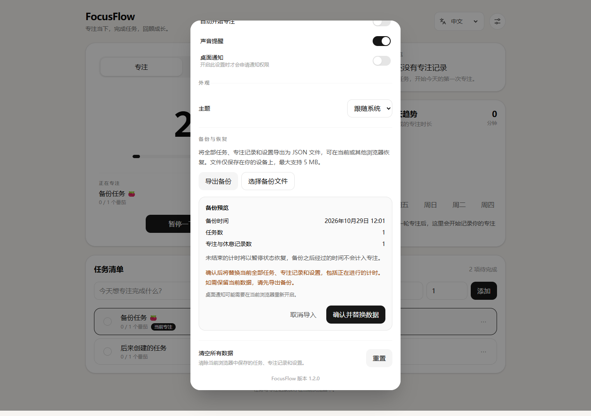

# FocusFlow v1.2.0 · 数据备份与恢复

日期：2026-10-29，Asia/Singapore。

## 使用流程

打开右上角设置，在“备份与恢复”中选择“导出备份”，下载包含全部任务、专注与休息记录、计时状态和设置的 JSON 文件。文件保存在用户设备，不上传服务端。

选择备份文件后，应用先校验并展示备份时间、任务数与记录数；确认替换后恢复，取消导入则不改变当前数据。该操作会覆盖当前数据及正在进行的计时，界面提示先导出当前备份。



该图取自正式站点的独立验收上下文，使用示例任务。手机与英文暗色截图见 `docs/screenshots/v1.2/production/backup/`。

## 数据与失败处理

- 文件格式 `focusflow-backup`，文件版本 1，业务 schema 沿用 V2；上限 5 MB。
- 导出使用运行中的最新状态，不依赖上一次保存的快照。计时按导出时刻校准，不改动正在运行的界面或 stores。
- 未结束的计时恢复为暂停，保留 Session ID 与备份时刻的剩余时间；备份之后经过的时间不计入专注。
- 旧 schema 经已有迁移后校验；未来文件 / 数据版本、字段损坏、重复 ID、孤立运行记录及不一致的计时状态均拒绝导入。
- 恢复先执行原子 `localStorage.setItem`，成功后才注入 stores。存储满、权限拒绝或校验失败时，当前存储和运行状态保持原样。
- 未来版本数据的写保护不被导入绕过，也不允许把保护状态下的默认数据导出成用户备份。
- 通知授权由当前浏览器决定，未授权时关闭导入的通知开关。
- 文件预览取消、选择新文件及关闭设置不会写入数据；异步读取不会在设置关闭后更新旧组件。

## 验证

以下为该版本的历史验证记录。当前版本的重跑命令见[部署说明](../DEPLOYMENT.md)，输出写入 `.artifacts/`；复验旧版本时须检出对应版本，并显式指定预期版本。

```bash
npm run check
node scripts/backup-acceptance.cjs
python scripts/browser-acceptance.py --expected-version 1.2.0 --output .artifacts/acceptance/local/business.json --screenshots-dir .artifacts/screenshots/local/business
python scripts/language-acceptance.py --expected-version 1.2.0 --output .artifacts/acceptance/local/language.json --screenshots-dir .artifacts/screenshots/local/language
```

本地浏览器验收前需启动开发服务。备份脚本需要 Node 可解析 `playwright/test`（本轮使用 Playwright 1.62.1，可通过 `NODE_PATH` 指向已有安装），另两个脚本的生产复验使用 Python 3.12 / Playwright 1.64.1；均使用已安装的 Microsoft Edge，不属于应用运行依赖。测试使用独立上下文和示例任务，Python 用例进一步隔离浏览器进程；计时由脚本推进，下载内容仅保存在临时目录，结束后删除。存储配额错误为刻意注入，单独记录，与非预期错误区分。

该版本自动化测试为 23 个文件、123 个用例通过。新增备份测试 23 项，覆盖核心校验、暂停恢复、预览 / 取消 / 确认、中英文和失败保护。

本地备份专项 **4/4**、业务回归 **11/11**、语言验收 **4/4**，均无非预期错误。备份专项覆盖真实下载、Unicode、预览取消不写入、覆盖恢复、同一 Session 刷新与继续、损坏 JSON、未来格式 / 数据版本，以及存储配额失败保留原数据。截图覆盖桌面、375 中文、390 英文暗色、横屏英文。

本地结果：[备份](acceptance/v1.2/local/backup.json)、[业务](acceptance/v1.2/local/business.json)、[语言](acceptance/v1.2/local/language.json)。

## 发布与生产验收

功能提交 `79aae93` 已正常推送，保留远端新增的部署文档提交。[CI #19](https://github.com/clear1613/FocusFlow/actions/runs/40891629650) 成功，Pages 已部署 v1.2.0；功能验收时的线上 JS 指纹 `index-pMmKB1_D.js` 与当时的本地 Pages 构建一致。

| 范围 | 实际结果 | 原始记录 |
| --- | --- | --- |
| 备份专项 | 4/4，0 非预期错误，0 导航重试 | [v1.2/production/backup.json](acceptance/v1.2/production/backup.json) |
| 语言验收 | 4/4，0 非预期错误，0 导航重试 | [v1.2/production/language.json](acceptance/v1.2/production/language.json) |
| 业务回归 | 11 项均通过：完整运行 9 项通过，2 项首次导航连接中断后单独重跑通过 | [覆盖汇总](acceptance/v1.2/production/business.json) |

业务汇总保留每项用例的原始文件指针，不将多次运行写成一次连续的 11/11：[完整运行](acceptance/v1.2/production/raw/business-attempt.json)、[通知不支持重跑](acceptance/v1.2/production/raw/business-unsupported_notification.json)、[权限请求失败重跑](acceptance/v1.2/production/raw/business-permission_failure.json)。两项重跑均无导航重试、无非预期应用错误。

验收期间出现过 `ERR_CONNECTION_CLOSED`，发生在初次文档导航阶段；之前不完整的运行保留在 [连接中断记录](acceptance/v1.2/production/raw/network-attempts.json)。脚本只对已知连接中断最多重试两次并记录，业务断言不重试、不放宽。更新测试工具并隔离 Python 用例的浏览器进程后完成复验。v1.1.0 的 71 项扩展 UI 与真实等待后台计时记录仍作为历史结果保留，本轮没有将它们记为重新运行。
