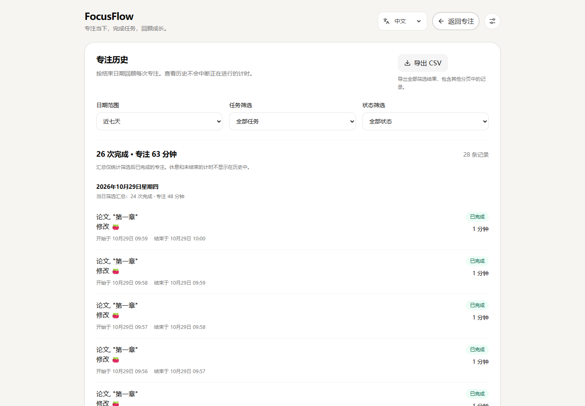

# FocusFlow v1.3.0 · 专注历史与复盘

## 使用

点击右上角“专注历史”进入记录视图，选择今天、近七天、近三十天或自定义日期，可组合任务与状态筛选。每天显示记录明细和当日筛选汇总；每页最多 20 条，导出 CSV 包含全部筛选结果。

查看历史时，正在进行的计时继续运行，完成后历史与汇总自动更新。点击“返回专注”回到工作台，原先未提交的任务输入仍然保留。中英文切换保留当前筛选条件。

## 口径

- 历史只列已结束的 Focus Session：已完成、已中断、已跳过；休息与运行 / 暂停中的 Session 不列入。
- 已完成记录以 `completedAt` 归档；中断、跳过以 `endedAt` 归档。跨午夜按结束日期归属，列表同时显示开始与结束日期时间。
- 日期按当前浏览器的本地自然日计算；结束边界为下一天零点，使用日历运算，兼容夏令时 23 / 25 小时的自然日。
- 默认近七天含今天和之前六天；近三十天含今天和之前二十九天。自定义日期包含起止两天，缺失、非法日期或起止倒置时提示并禁用导出。
- 列表、日期分组、顶部汇总和 CSV 使用相同的筛选结果。汇总仅计算已完成 Focus，先累加实际秒数再按现有统计口径四舍五入为分钟。
- 记录仍使用原有 Session 数据，不新增计数、不修改历史、不增加存储键或 schema。原有 V2 数据、备份文件格式保持兼容。
- 任务名称采用当前任务标题；任务已删除时显示“已删除任务”，未关联任务单独显示并可筛选。已有模型没有保存旧标题，不重建已删除名称。
- 每页 20 条，但每天的汇总覆盖筛选后该日的全部记录，不会随分页变少。CSV 同样不受当前分页限制。

## CSV

文件名包含筛选起止日期。字段为归档日期、任务、开始时间（含时区）、结束时间（含时区）、状态、实际时长（秒）和计划时长（秒）。时间保留当前本地 UTC 偏移，时长保留秒数。

使用 UTF-8 BOM、CRLF 行分隔及双引号转义，支持中文、逗号、引号和多行标题。对可能被电子表格解释为公式的标题（含前导空白或控制字符）加文本前缀，原有任务和 JSON 备份数据保持原样。字段标题及状态随当前界面语言导出。

## 实现

- [historyService](../src/services/historyService.ts)：日期校验、筛选、排序、日期分组和汇总，纯计算且不修改输入数据。
- [historyCsvService](../src/services/historyCsvService.ts)：双语文本、精确时间与秒数、CSV 转义和公式文本保护。
- [HistoryView](../src/components/history/HistoryView.tsx)：筛选、分页、空状态、错误反馈、实际文件下载、午夜与数据变化时重新计算。
- [App](../src/App.tsx)：切换视图时保持计时器和任务输入挂载；图表仅在工作台显示时挂载，避免隐藏容器尺寸警告。

## 本地验证

`npm run check`：26 个测试文件、148 项用例通过，lint / 类型 / 构建 / 发布校验通过。新增 25 项，包含查询与 CSV 19 项、界面 5 项、历史视图计时完成与草稿保留 1 项。

查询与 CSV 的 19 项测试另在 `TZ=America/New_York` 下全部通过，覆盖夏令时结束当天的日期边界。

[历史专项](acceptance/v1.3/local/history.json) **4/4**，使用本地 Pages 构建与 `/FocusFlow/` 子路径，桌面中文、375 中文、390 英文暗色、812×375 横屏英文；无非预期页面或控制台错误 / 警告。验证真实下载、BOM、多行文本与公式保护、跨页全量导出、日期 / 任务 / 状态筛选、跨午夜、汇总一致性、切换语言和视图、计时完成幂等，以及清空数据后导入备份使历史立即恢复。

原有功能本地回归：[业务](acceptance/v1.3/local/business.json) **11/11**、[语言](acceptance/v1.3/local/language.json) **4/4**、[备份](acceptance/v1.3/local/backup.json) **4/4**，均无非预期应用错误。

本地截图位于 `docs/screenshots/v1.3/local/history/`。

## 发布与生产验收

2026-10-29 正常推送功能提交 `35f988e`，[CI #21](https://github.com/clear1613/FocusFlow/actions/runs/40905599700) 成功并部署 Pages；2026-10-30 完成生产复验。未改写已有提交或旧版本验收数字。

| 范围 | 已验证覆盖 | 原始记录 |
| --- | --- | --- |
| 历史专项 | 4 项均通过；完整运行 3 项通过，横屏初次导航失败后单独通过 | [覆盖汇总](acceptance/v1.3/production/history.json)、[完整运行](acceptance/v1.3/production/raw/history-attempt.json)、[横屏重跑](acceptance/v1.3/production/raw/history-landscape-en.json) |
| 语言 | 4 项均通过；完整运行 3 项通过，横屏初次导航失败后单独通过 | [覆盖汇总](acceptance/v1.3/production/language.json)、[完整运行](acceptance/v1.3/production/raw/language-attempt.json)、[横屏重跑](acceptance/v1.3/production/raw/language-landscape.json) |
| 业务 | 11 项均通过；完整运行 6 项通过，5 项初次导航失败后单独通过 | [覆盖汇总与逐项原始指针](acceptance/v1.3/production/business.json)、[完整运行](acceptance/v1.3/production/raw/business-attempt.json) |
| 备份 | 完整运行 4/4 | [原始结果](acceptance/v1.3/production/backup.json) |

所有实际执行的业务断言均保留。失败发生在初始文档导航的 `ERR_CONNECTION_CLOSED`，通过原脚本 `--case` 单独重跑；不重试或放宽业务断言。三个覆盖汇总明确标注合并来源，未记作一次连续全通过；非预期应用错误为 0，备份中刻意注入的存储错误单独记录。v1.1.0 的真实等待后台计时仍是历史验证，本轮没有重新运行。

正式截图统一位于 `docs/screenshots/v1.3/production/`，按 `history`、`language`、`business`、`backup` 分类。下图取自线上独立测试上下文，使用示例任务：



## 重跑

浏览器脚本需要 Python Playwright 和已安装的 Edge；本轮使用 Python 3.12 / Playwright 1.64.1，独立于应用依赖。先启动本地服务：

```bash
npm run dev -- --host 127.0.0.1
python scripts/history-acceptance.py
python scripts/browser-acceptance.py --expected-version 1.3.0 --output .artifacts/acceptance/local/business.json --screenshots-dir .artifacts/screenshots/local/business
python scripts/language-acceptance.py --expected-version 1.3.0 --output .artifacts/acceptance/local/language.json --screenshots-dir .artifacts/screenshots/local/language
node scripts/backup-acceptance.cjs --expected-version 1.3.0 --output .artifacts/acceptance/local/backup.json --screenshots-dir .artifacts/screenshots/local/backup
```

备份脚本另外需要 Node 能解析 `playwright/test`（本轮沿用 1.62.1）。新运行默认写入 `.artifacts/`，不覆盖本页归档证据。生产复验为各命令追加 `--url https://clear1613.github.io/FocusFlow/` 并指定新的 production 结果和截图目录；业务脚本还需 `--production`。测试使用独立浏览器与示例数据，计时由脚本推进；CSV 下载到经过路径校验的临时目录，结束后删除。
