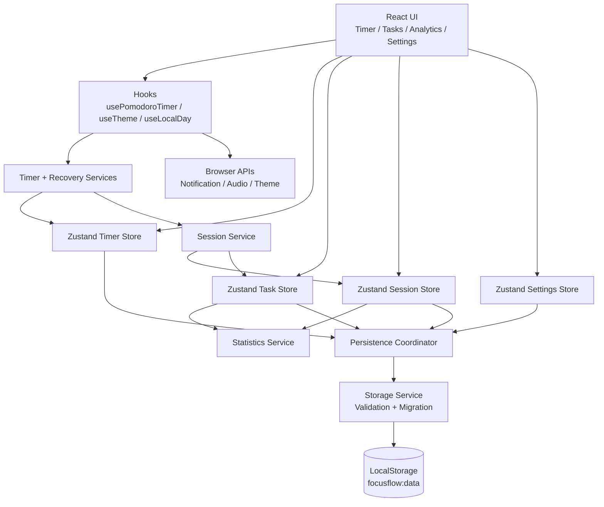
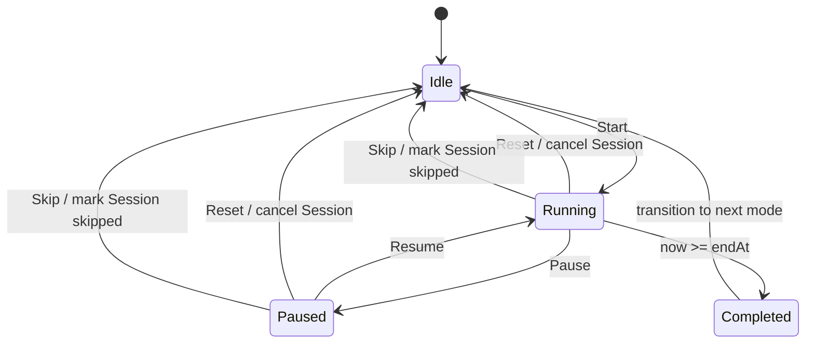
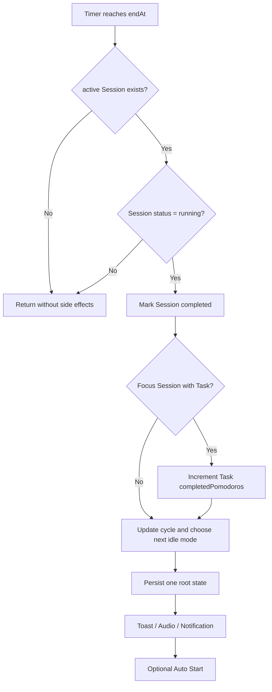
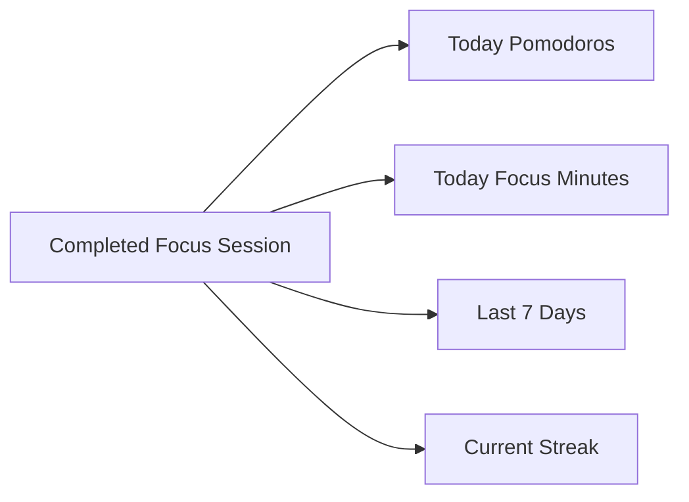
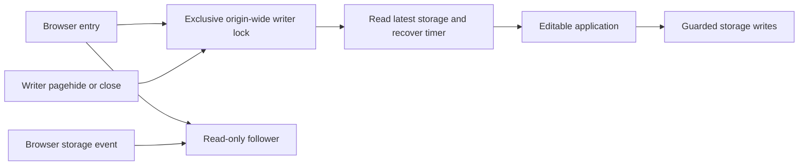

# FocusFlow Architecture

FocusFlow is a local-first single-page application. V1.0 deliberately has no backend, authentication layer, or remote database.

## System overview



## Timer state machine



The timer does **not** use `remainingSeconds--` as the source of truth. While running, the remaining time is recomputed from:

```text
remaining = max(0, ceil((endAt - now) / 1000))
```

`setInterval` is only a UI refresh trigger. This lets the timer recover from browser background throttling and refreshes.

## Session completion



The Session ID is the idempotency boundary. Late interval callbacks, `visibilitychange`, and app recovery cannot complete the same Session twice.

Natural completion writes `endedAt` and `completedAt` from the timer's deadline (`endAt`), including delayed callbacks and offline recovery. Reopening tomorrow cannot move yesterday's completed focus into today's analytics. Active duration remains the Session's planned countdown duration, excluding pauses.

## Persistence

FocusFlow persists one versioned root object:

```text
focusflow:data
├── version
├── tasks[]
├── sessions[]
├── activeTaskId
├── timer
└── settings
```

Read path:

```text
LocalStorage
  → JSON parse
  → detect version
  → migrate legacy schema
  → field-level validation
  → timer recovery
  → hydrate stores before React mount
```

Write path:

```text
Store state
  → assemble one PersistedAppData object
  → schema validation
  → LocalStorage write
```

A future schema version activates write protection instead of allowing an older app build to overwrite newer data.

`initializeApp()` runs before React mounts. Recovery/migration feedback is emitted once and safe state is persisted before the timer hook starts. Storage read exceptions fall back without crashing the app. Daily analytics refresh at local midnight and when a background page becomes visible, without persisting derived counters.

## Analytics model

Analytics does not persist independent counters such as `todayPomodoros` or `weeklyMinutes`. Completed Focus Sessions are the fact source.



This keeps historical statistics stable even when the user later changes Focus duration or deletes a Task.

## Key invariants

1. At most one `activeSessionId` exists at a time.
2. A Session can be completed only once.
3. One completed Focus Session can increment a Task at most once.
4. Running Timer requires `endAt` and `activeSessionId`.
5. Paused Timer has `endAt = null`.
6. Deleting a Task never deletes Session history.
7. Statistics are derived from Sessions.
8. Persisted schema changes require migration + validation updates.

## Multi-window ownership and deferred panels (v1.4)



Only the lock holder performs business writes, timer completion and reminders. A queued follower hydrates saved snapshots without recovery side effects, and rereads current storage after acquiring ownership. Page lifecycle cleanup revokes access before releasing the lock; storage and timer callbacks independently enforce permissions. Unsupported coordination keeps the page read-only. The V2 data schema and version 1 backup format remain unchanged.

Charts, history, settings and tasks load as separate modules. Local error boundaries preserve the timer if a panel fails to load. The build checks a 300,000-byte entry budget; this measures entry JavaScript, not whole-page transfer or network timing. See [reliability design and acceptance](16-RELIABILITY.md).
